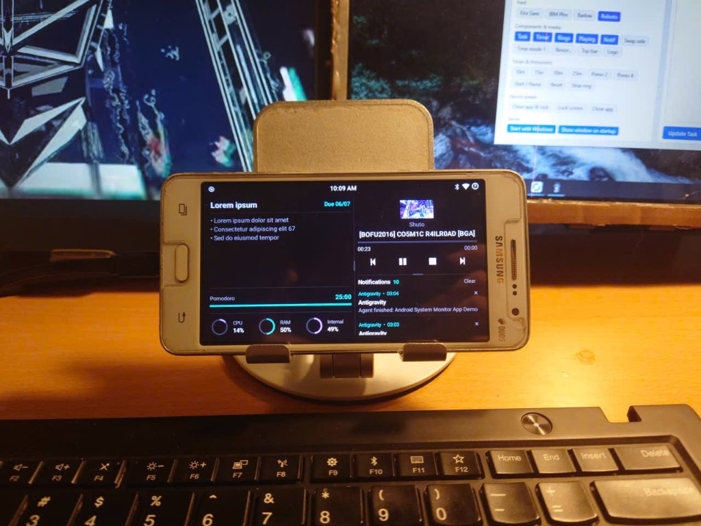

# Deskmon

Deskmon brings live information from your PC to an Android phone display. Built to turn an unused phone into a compact desk companion for system stats, tasks, media controls, and Windows notifications.



## Release

| Component | File | Platform |
| --- | --- | --- |
| Deskmon server | `windows-server/dist/DeskmonServer.exe` | Windows 10/11 |
| Deskmon | `android-app/dist/Deskmon-release.apk` | Android 7.0+ |

## Features

- Live CPU, RAM, and storage usage
- Current task, due time, and formatted notes
- Now Playing track info, artwork, progress, and media controls
- Windows toast notification mirroring with dismiss and clear
- Focus timer and Pomodoro cycles
- 3 customizable layouts with server-side preference sync
- Auto-connect over Wi-Fi, USB, or Bluetooth
- Standalone tray server and lightweight R8-minified APK

## Building

### Deskmon server

Requires Windows 10/11 with .NET Framework 4.x `csc.exe` and Windows WinMetadata. Built with C#, WPF, Win32, and WinRT APIs.

```powershell
$csc = "C:\Windows\Microsoft.NET\Framework64\v4.0.30319\csc.exe"
$wpf = "C:\Windows\Microsoft.NET\Framework64\v4.0.30319\WPF"
$winmd = "C:\Windows\System32\WinMetadata"

& $csc /nologo /target:winexe /optimize+ /out:windows-server\dist\DeskmonServer.exe `
  /win32icon:windows-server\wpf-ui\hibiki.ico `
  /r:"$wpf\PresentationFramework.dll" /r:"$wpf\PresentationCore.dll" /r:"$wpf\WindowsBase.dll" `
  /r:System.Xaml.dll /r:System.Windows.Forms.dll /r:System.Drawing.dll /r:System.Web.Extensions.dll /r:System.Runtime.dll `
  /r:"$winmd\Windows.Foundation.winmd" /r:"$winmd\Windows.Media.winmd" /r:"$winmd\Windows.UI.winmd" `
  /r:"$winmd\Windows.Storage.winmd" /r:"$winmd\Windows.ApplicationModel.winmd" `
  windows-server\wpf-ui\Program.cs windows-server\wpf-ui\Backend.cs
```

### Deskmon

Requires JDK 17+ and Android SDK. Built with Kotlin, Material Components, and Gradle.

```powershell
cd android-app
.\gradlew assembleRelease
```

The release APK is generated at `android-app/app/build/outputs/apk/release/app-release.apk`.

## License

This project is released into the public domain under [The Unlicense](LICENSE).
